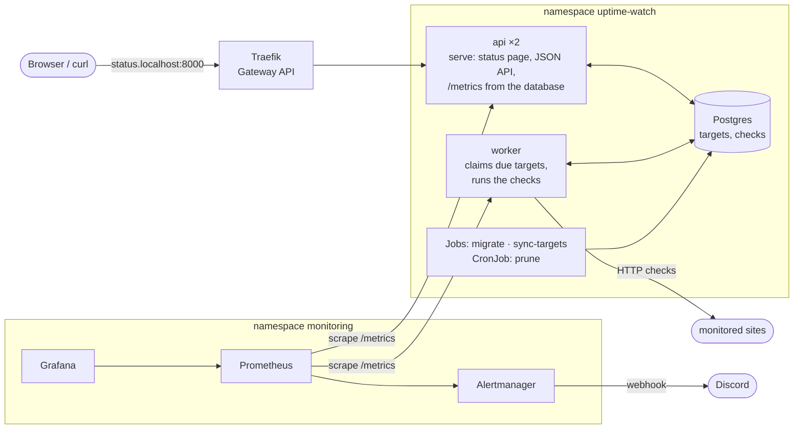
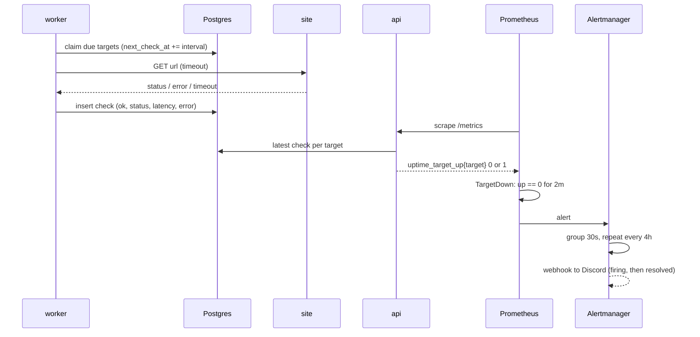
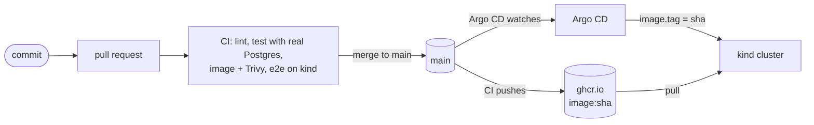

# Architecture

How the pieces fit, in four pictures. The "why" behind each choice is in
[the decision records](adr/); what to do when something breaks is in
[the runbook](runbook.md).

## Components



- The **worker** claims due targets with `FOR UPDATE SKIP LOCKED`, so several
  replicas never check the same target ([0001](adr/0001-schedule-checks-in-postgres.md)).
- The **API** exports the state of every target from the database at scrape
  time; workers export only their own counters ([0003](adr/0003-alerting-in-the-platform.md)).
- **Alerts** are `PrometheusRule`s in the Helm chart; Alertmanager groups them
  and sends them to Discord.

## One check, from schedule to alert



## From a commit to the cluster



Deploying a new version is a commit that changes `image.tag` to a SHA that CI
pushed; rolling back is `git revert` ([0004](adr/0004-gitops-with-argo-cd.md)).
Inside one sync of the app, the order is:

```
PreSync   migrate Job          tables up to date before the new pods
Sync      ConfigMaps, Deployments, Services, HTTPRoute ...
PostSync  sync-targets Job     the database matches gitTargets
```

## How Argo CD builds the cluster

`bootstrap.sh` installs Argo CD, creates the generated Secrets and applies the
root Application. Everything else comes from `deploy/argocd/apps/`, one wave
after the other; each wave waits until the previous one is healthy.

| Wave | Application | Why here |
|---|---|---|
| -3 | `gateway-api` | CRDs that Traefik and every route need |
| -2 | `traefik` | the entry point, before anything adds a route |
| -1 | `monitoring` | Prometheus Operator CRDs that the app's ServiceMonitor needs |
| 0 | `postgres` | the app's database |
| 1 | `uptime-watch` | the app (migrate → pods → sync-targets) |
| 2 | `routes` | routes to the platform UIs, once their Services exist |

## Where state lives

| What | Where | Survives a rebuild? |
|---|---|---|
| Code, chart, cluster config, alert rules | git | yes |
| Permanent targets (`gitTargets`) | git → ConfigMap → database | yes, re-synced |
| Targets added with the API or the form | database | no |
| Check history | database | no (backups: an idea in the README) |
| Postgres password, `ADMIN_TOKEN` | Secrets made by `bootstrap.sh` | no, regenerated |
| Discord webhook | Secret, typed in with `make kind-discord-secret` | no, typed again |
